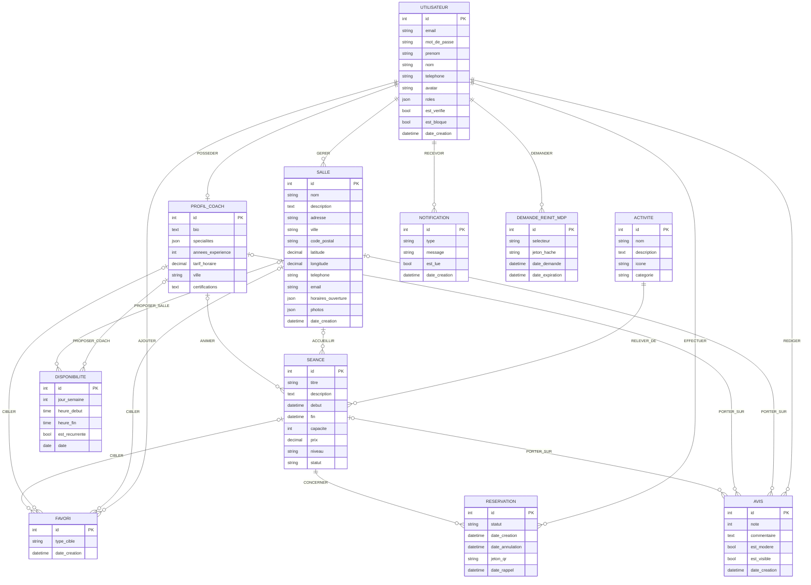
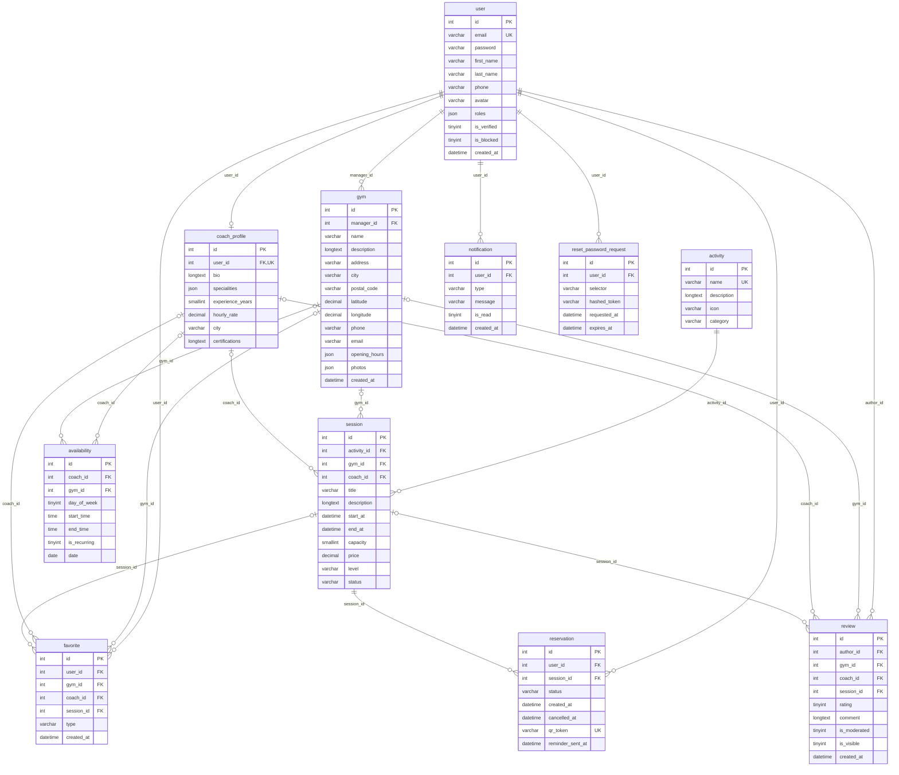

# Cahier des charges — FitBook

> Projet de formation **UAA MI08 — Produire un projet Web**
> Version 1.0 — 5 novembre 2026 — statut : **à valider par les formateurs**

---

## 1. Contexte

Trouver une salle de sport, un cours collectif ou un coach disponible demande aujourd'hui
de consulter plusieurs sites, d'appeler, puis de réserver par téléphone ou sur place.
**FitBook** regroupe cette offre sur une seule plateforme web : on cherche, on compare,
on réserve et on donne son avis.

Une première version de FitBook existe déjà (catalogue de séances, inscription avec
vérification d'e-mail, connexion, profil, réservation). Le présent cahier des charges
décrit la **version cible 1.0**, qui reprend cette base, son identité visuelle et ses
médias, et l'étend aux quatre rôles de la plateforme.
L'écart entre l'existant et la cible est détaillé dans [`analyse-existant.md`](analyse-existant.md).

## 2. Objectifs

| # | Objectif | Indicateur de réussite |
|---|----------|------------------------|
| O1 | Permettre à un sportif de trouver et réserver une séance en moins de 2 minutes | Parcours recherche → réservation en 4 écrans maximum |
| O2 | Donner aux coachs et aux salles un outil de gestion de leurs séances | CRUD séances + calendrier + liste des inscrits |
| O3 | Garantir des réservations fiables | Aucune sur-réservation possible (capacité contrôlée en base) |
| O4 | Offrir une plateforme sûre | Protection documentée contre les 10 risques OWASP Top 10 |
| O5 | Livrer un code maintenable et évaluable | Code commenté en français, tests automatisés, documentation complète |

## 3. Périmètre

### 3.1 Inclus (version 1.0)

- Recherche avancée de salles, coachs et séances (texte, ville, activité, dates, prix, niveau, note, distance).
- Fiches détaillées : salle, coach, séance (photos, horaires, calendrier, avis, note moyenne).
- Comptes avec **4 rôles** : sportif, coach, gestionnaire de salle, administrateur.
- Inscription avec choix du rôle, confirmation par e-mail, connexion JWT, mot de passe oublié.
- Réservation avec contrôle de capacité, annulation (jusqu'à 2 h avant la séance), historique.
- Favoris, avis notés (1 à 5) avec modération.
- Espaces dédiés : sportif, coach, gestionnaire, administrateur.
- E-mails transactionnels : confirmation d'inscription, de réservation, d'annulation, rappel 24 h (bonus).
- Tableaux de bord statistiques (gestionnaire, administrateur).

### 3.2 Bonus (si le temps le permet)

- Carte Leaflet et recherche par distance.
- QR code de réservation.
- Notifications internes.
- Rappel automatique 24 h avant la séance (commande planifiée).

### 3.3 Exclus

- Paiement en ligne (le prix est affiché, le règlement se fait sur place).
- Application mobile native (le site est responsive).
- Messagerie entre utilisateurs.

## 4. Acteurs et rôles

| Rôle | Code Symfony | Description |
|------|--------------|-------------|
| Visiteur | *(non connecté)* | Consulte le catalogue, la recherche et les fiches |
| Sportif | `ROLE_SPORTIF` | Réserve des séances, gère ses favoris et ses avis |
| Coach | `ROLE_COACH` | Propose des séances, gère ses disponibilités et voit ses inscrits |
| Gestionnaire | `ROLE_GESTIONNAIRE` | Gère une ou plusieurs salles, leurs cours et leurs statistiques |
| Administrateur | `ROLE_ADMIN` | Gère toute la plateforme et modère les avis |

**Hiérarchie :** `ROLE_ADMIN` hérite de tous les autres rôles.
**Propriété des ressources :** un coach ne modifie que *ses* séances, un gestionnaire que
*ses* salles (contrôlé par des Voters Symfony).
Le compte administrateur n'est jamais créé par inscription : il est fourni par les fixtures.

Le détail des besoins par rôle figure dans [`user-stories.md`](user-stories.md) et
[`use-cases.md`](use-cases.md).

## 5. Exigences fonctionnelles

| ID | Exigence | Rôles |
|----|----------|-------|
| EF-01 | Rechercher salles, coachs et séances avec filtres, tri et pagination | Tous |
| EF-02 | Consulter la fiche d'une salle, d'un coach ou d'une séance | Tous |
| EF-03 | Créer un compte en choisissant son rôle (sportif, coach, gestionnaire) | Visiteur |
| EF-04 | Être connecté automatiquement après l’inscription (compte actif dès sa création) | Visiteur |
| EF-05 | Se connecter (JWT), se déconnecter, réinitialiser son mot de passe | Tous |
| EF-06 | Réserver une séance si des places restent ; jamais deux fois la même | Sportif |
| EF-07 | Annuler une réservation au plus tard 2 h avant le début de la séance | Sportif |
| EF-08 | Gérer ses favoris (salle, coach, séance) | Sportif |
| EF-09 | Laisser un avis noté, un seul par cible, après une séance terminée | Sportif |
| EF-10 | Gérer son profil (et son avatar) | Tous les connectés |
| EF-11 | CRUD de ses séances et de ses disponibilités, liste des inscrits | Coach |
| EF-12 | CRUD de ses salles, cours, horaires, capacités ; statistiques de salle | Gestionnaire |
| EF-13 | CRUD des utilisateurs (changer le rôle, bloquer), salles, coachs, activités, réservations | Admin |
| EF-14 | Modérer les avis (valider, masquer) | Admin |
| EF-15 | Recevoir les e-mails de confirmation, d'annulation et de rappel | Sportif |

## 6. Règles de gestion

| ID | Règle |
|----|-------|
| RG-01 | Une adresse e-mail correspond à un seul compte. |
| RG-02 | Un compte est actif dès sa création ; seul un compte bloqué ne peut pas se connecter. |
| RG-03 | Une réservation n'est acceptée que si `réservations confirmées < capacité` ; sinon réponse **409**. Le contrôle est fait dans une transaction avec verrou pessimiste **et** dans la procédure `sp_reserver_seance`. |
| RG-04 | Un sportif ne peut pas réserver deux fois la même séance. |
| RG-05 | Une réservation est annulable uniquement si la séance commence dans **plus de 2 heures** (`sp_annuler_reservation`). |
| RG-06 | Un avis n'est possible qu'après une réservation **terminée** sur la cible (ou une séance de la cible). |
| RG-07 | Un seul avis par utilisateur et par cible ; note entière de 1 à 5. |
| RG-08 | Un avis est publié immédiatement (`isVisible = true`, `isModerated = false`). L'administrateur le **valide** (`isModerated = true`) ou le **masque** (`isVisible = false`) ; un avis masqué n'apparaît plus et ne compte plus dans la note moyenne. |
| RG-09 | Une séance a une date de fin postérieure à sa date de début et une capacité ≥ 1. |
| RG-10 | Une séance est rattachée à une salle **et/ou** un coach (au moins l'un des deux). |
| RG-11 | Seul le propriétaire (coach ou gestionnaire) ou un administrateur peut modifier ou supprimer une ressource. |
| RG-12 | Une séance annulée ne peut plus être réservée ; ses réservations confirmées sont annulées et les sportifs prévenus par e-mail. |

## 7. Exigences non fonctionnelles

| Domaine | Exigence |
|---------|----------|
| **Sécurité** | Mots de passe hachés (bcrypt/argon2), JWT, CORS restreint, limitation des tentatives de connexion, requêtes paramétrées, aucun secret versionné (`.env.local`), utilisateur MySQL dédié `fitbook_user` (jamais `root`). Détail dans `docs/securite.md` (Phase 9). |
| **Validation** | Tous les formulaires validés côté serveur (Symfony Validator) avec des erreurs JSON `{ "errors": { "champ": "message" } }` ; corps de `POST /api/reservations` validé par JSON Schema. |
| **Ergonomie** | Responsive *mobile-first* (mobile, tablette, desktop), mode sombre optionnel, toasts, loaders, états vides. |
| **Accessibilité** | Libellés de formulaire, contrastes AA, navigation clavier, focus visible. |
| **Performance** | Recherche paginée ; temps de réponse API < 500 ms sur les jeux de données des fixtures. |
| **Qualité** | Code aéré, indenté, commenté en français ; PHPStan niveau 6, PHP-CS-Fixer, ESLint + Prettier. |
| **Tests** | PHPUnit (unitaires + intégration), tests Angular, collection Postman exécutée par Newman. |
| **Sauvegarde** | Script `mysqldump` horodaté + 3 dumps jalons (`01_debut`, `02_milieu`, `03_fin`). |

## 8. Charte graphique

L'identité visuelle de la version actuelle est **conservée** : mêmes couleurs, mêmes
photographies et vidéos, même marque « FitBook ». Les nouveaux écrans réutilisent ces jetons.

| Usage | Couleur |
|-------|---------|
| Couleur principale (boutons, liens, accents) | `#ff642d` — survol `#e84e1e` |
| Titres, en-têtes, pied de page | `#10213a` (bleu nuit) — variante `#071b3a` |
| Texte courant | `#536174` |
| Fond des sections et formulaires | `#f5f7fa` — cartes `#ffffff` |
| Bordures | `#e1e5eb` |
| Succès | `#167044` |
| Erreur | `#a52b1a` — bordure de champ `#b42318` |

- Coins arrondis : 18 px (cartes), 10 px (champs), 30 px (boutons).
- Médias : photographies sportives existantes et vidéo de présentation (accueil, fiches).
- Mode sombre (optionnel) : dérivé de ces mêmes couleurs, fond bleu nuit `#10213a`.

## 9. Contraintes techniques

| Couche | Choix imposé |
|--------|--------------|
| Frontend | Angular 21 (standalone, signals, routes *lazy-loaded*), SCSS/CSS, FullCalendar, Leaflet (bonus), toasts, angularx-qrcode (bonus) |
| Backend | PHP 8.3+, Symfony 7 (API REST JSON), Doctrine ORM, LexikJWTAuthenticationBundle, Symfony Mailer, Symfony Validator, NelmioApiDocBundle |
| Base de données | MySQL 8, utilisateur dédié `fitbook_user`, 3 procédures stockées |
| E-mails en développement | Mailpit |
| Gestion de projet | Git + GitFlow (`main`, `develop`, `feature/*`, `release/*`, `hotfix/*`) |

**Environnement du poste de développement :** Windows 11 avec WAMP (PHP 8.3, **MySQL 9.1**).
Le schéma n'utilise que des fonctionnalités de MySQL 8 (JSON, `CHECK`, procédures stockées) : il reste
compatible avec la version imposée, et le `docker-compose.yml` fournira une image `mysql:8`.
Docker n'est pas installé : le `docker-compose.yml` (MySQL, phpMyAdmin, Mailpit) sera fourni
pour la reproductibilité, mais l'installation documentée couvrira aussi WAMP + Mailpit natif.

## 10. Livrables

| Livrable | Emplacement |
|----------|-------------|
| Code source | `backend/`, `frontend/` |
| Procédures stockées, scripts, sauvegardes | `database/` |
| Collection et rapport Postman | `postman/` |
| Analyse : cahier des charges, user stories, MCD, MLD, cas d'utilisation, diagramme de classes | `docs/` |
| Sécurité, liste des tests, déploiement | `docs/` (Phases 9–10) |
| Guide d'installation, comptes de démo | `README.md` |

## 11. Planning

| Phase | Contenu | Validation |
|-------|---------|------------|
| 1 | Analyse : GitFlow, arborescence, documentation | **Validation formateurs** |
| 2 | Base de données et socle backend | Migrations + fixtures + `01_debut.sql` |
| 3 | Authentification, rôles, voters | Tests auth verts |
| 4 | API métier, recherche, réservations, e-mails | Tests API verts |
| 5 | Socle frontend, design system, auth | Build + tests verts |
| 6 | Pages publiques, espace sportif | Parcours réservation complet |
| 7 | Espaces coach, gestionnaire, admin | Calendriers + statistiques |
| 8 | Bonus : carte, distance, QR code, rappels | — |
| 9 | Tests et qualité, sécurité, sauvegardes | Rapport Newman, `02_milieu`, `03_fin` |
| 10 | Finalisation, `release/1.0.0`, tag `v1.0.0` | Livraison |

Aucune phase ne démarre tant que la précédente ne compile pas et que ses tests ne passent pas.

---

## 12. Analyse et modélisation

Les éléments d'analyse demandés par l'énoncé sont intégrés ci-dessous ; chaque document détaillé
(dictionnaire de données, cardinalités, contraintes, scénarios) reste dans `docs/`.

| Élément | Contenu | Document détaillé |
|---------|---------|-------------------|
| User stories | 32 stories par rôle, avec critères d'acceptation | [`user-stories.md`](user-stories.md) |
| MCD (Merise) | Entités, associations et cardinalités | [`mcd.md`](mcd.md) |
| MLD (MySQL) | Tables, clés, contraintes, procédures stockées | [`mld.md`](mld.md) |
| Cas d'utilisation (UML) | Acteurs, diagramme et scénarios détaillés | [`use-cases.md`](use-cases.md) |
| Diagramme de classes (UML) | Domaine et architecture du backend | [`diagramme-classes.md`](diagramme-classes.md) |

### 12.1 Modèle conceptuel de données (MCD)

### 12.2 Modèle logique de données (MLD)

