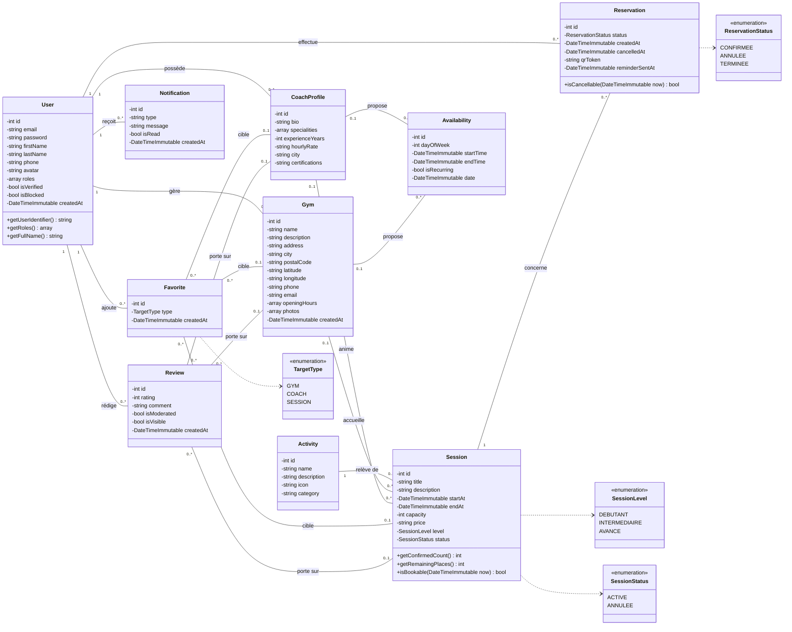
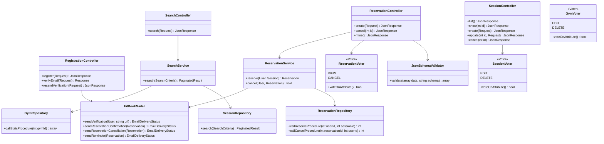

# Diagramme de classes — FitBook

> Version 1.0 — 5 novembre 2026 — statut : **à valider par les formateurs**
> À reproduire dans **StarUML**. Cohérent avec le [MLD](mld.md).

Deux vues :
1. **Domaine** : les entités Doctrine, leurs attributs et leurs associations.
2. **Architecture backend** : comment contrôleurs, services, voters et repositories collaborent.

---

## 1. Modèle du domaine (entités Doctrine)

Notes :
- `User` implémente `UserInterface` et `PasswordAuthenticatedUserInterface` (sécurité Symfony).
- Les montants (`price`, `hourlyRate`) et coordonnées sont typés `string` en PHP : c'est ainsi
  que Doctrine restitue les colonnes `DECIMAL`, sans perte de précision.
- `ResetPasswordRequest` (fournie par SymfonyCasts ResetPasswordBundle) n'est pas représentée.

## 2. Architecture backend

Requête type : **Contrôleur → (Validator / JSON Schema) → Voter → Service → Repository → MySQL**.

| Couche | Responsabilité | Exemples |
|--------|----------------|----------|
| Contrôleur | Lit la requête, renvoie le JSON et le bon code HTTP | `ReservationController` |
| Validation | Symfony Validator (attributs sur les DTO/entités) et JSON Schema (`opis/json-schema`) | `JsonSchemaValidator` |
| Voter | Décide si l'utilisateur peut agir sur **cette** ressource (propriété) | `SessionVoter`, `GymVoter` |
| Service | Règles métier, transactions, e-mails | `ReservationService` |
| Repository | Requêtes Doctrine paramétrées et appels SQL natifs aux procédures stockées | `ReservationRepository` |

La liste complète des contrôleurs et des services sera établie en Phase 4. Cette vue fixe les
principes : aucune règle métier dans les contrôleurs, aucun SQL hors des repositories.
