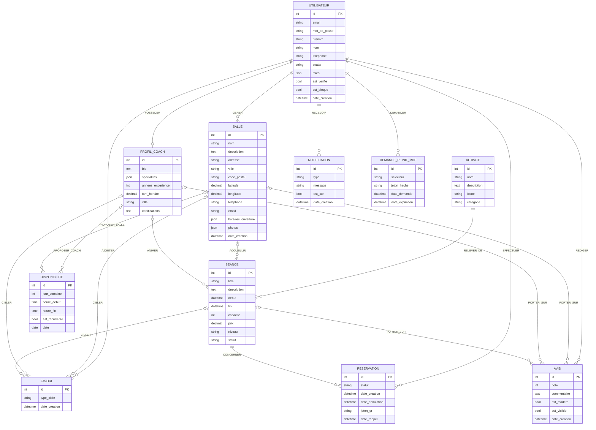

# MCD — Modèle conceptuel de données

> Version 1.0 — 5 novembre 2026 — statut : **à valider par les formateurs**
> À reproduire dans **JMerise**. Le modèle logique correspondant est dans [`mld.md`](mld.md).

Les cardinalités suivent la notation Merise **(min, max)**, lues depuis l'entité vers l'association.
Exemple : `UTILISATEUR (0,n) — EFFECTUER — (1,1) RESERVATION` se lit
« un utilisateur effectue de 0 à n réservations ; une réservation est effectuée par exactement un utilisateur ».

---

## 1. Dictionnaire des entités

| Entité | Identifiant | Attributs |
|--------|-------------|-----------|
| **UTILISATEUR** (User) | id | email, mot de passe (haché), prénom, nom, téléphone, avatar, rôles, est vérifié, est bloqué, date de création |
| **PROFIL_COACH** (CoachProfile) | id | bio, spécialités, années d'expérience, tarif horaire, ville, certifications |
| **SALLE** (Gym) | id | nom, description, adresse, ville, code postal, latitude, longitude, téléphone, e-mail, horaires d'ouverture, photos, date de création |
| **ACTIVITE** (Activity) | id | nom, description, icône, catégorie |
| **SEANCE** (Session) | id | titre, description, début, fin, capacité, prix, niveau, statut |
| **DISPONIBILITE** (Availability) | id | jour de la semaine, heure de début, heure de fin, est récurrente, date |
| **RESERVATION** (Reservation) | id | statut, date de création, date d'annulation, jeton QR, date d'envoi du rappel |
| **FAVORI** (Favorite) | id | type de cible, date de création |
| **AVIS** (Review) | id | note, commentaire, est modéré, est visible, date de création |
| **NOTIFICATION** (Notification) | id | type, message, est lue, date de création |
| **DEMANDE_REINIT_MDP** (ResetPasswordRequest) | id | sélecteur, jeton haché, date de demande, date d'expiration |

Valeurs énumérées :

- **rôles** : `ROLE_SPORTIF`, `ROLE_COACH`, `ROLE_GESTIONNAIRE`, `ROLE_ADMIN`
- **niveau** (séance) : `debutant`, `intermediaire`, `avance`
- **statut** (séance) : `active`, `annulee`
- **statut** (réservation) : `confirmee`, `annulee`, `terminee`
- **type de cible** (favori) : `gym`, `coach`, `session`

## 2. Associations et cardinalités

| Association | Entité A | Card. A | Card. B | Entité B | Signification |
|-------------|----------|---------|---------|----------|---------------|
| POSSEDER | UTILISATEUR | 0,1 | 1,1 | PROFIL_COACH | Un compte coach possède un profil coach |
| GERER | UTILISATEUR | 0,n | 1,1 | SALLE | Un gestionnaire gère des salles ; une salle a un gestionnaire |
| RELEVER_DE | SEANCE | 1,1 | 0,n | ACTIVITE | Une séance porte sur une activité |
| ACCUEILLIR | SALLE | 0,n | 0,1 | SEANCE | Une séance peut avoir lieu dans une salle |
| ANIMER | PROFIL_COACH | 0,n | 0,1 | SEANCE | Une séance peut être animée par un coach |
| EFFECTUER | UTILISATEUR | 0,n | 1,1 | RESERVATION | Un sportif effectue des réservations |
| CONCERNER | SEANCE | 0,n | 1,1 | RESERVATION | Une réservation porte sur une séance |
| PROPOSER_COACH | PROFIL_COACH | 0,n | 0,1 | DISPONIBILITE | Créneau d'un coach |
| PROPOSER_SALLE | SALLE | 0,n | 0,1 | DISPONIBILITE | Créneau d'une salle |
| AJOUTER | UTILISATEUR | 0,n | 1,1 | FAVORI | Un utilisateur ajoute des favoris |
| CIBLER_SALLE / _COACH / _SEANCE | FAVORI | 0,1 | 0,n | SALLE / PROFIL_COACH / SEANCE | Cible du favori |
| REDIGER | UTILISATEUR | 0,n | 1,1 | AVIS | Un utilisateur rédige des avis |
| PORTER_SUR_SALLE / _COACH / _SEANCE | AVIS | 0,1 | 0,n | SALLE / PROFIL_COACH / SEANCE | Cible de l'avis |
| RECEVOIR | UTILISATEUR | 0,n | 1,1 | NOTIFICATION | Un utilisateur reçoit des notifications |
| DEMANDER | UTILISATEUR | 0,n | 1,1 | DEMANDE_REINIT_MDP | Demandes de réinitialisation du mot de passe |

> **Réservation : entité ou association ?** Une réservation est une association porteuse entre
> UTILISATEUR et SEANCE, mais elle possède son propre identifiant (jeton QR, historique,
> référencée par les e-mails). Elle est donc modélisée comme une **entité** reliée par deux
> associations (1,1).

## 3. Contraintes d'intégrité

| ID | Contrainte | Règle de gestion |
|----|------------|------------------|
| CI-01 | `email` unique | RG-01 |
| CI-02 | Un même utilisateur ne réserve pas deux fois la même séance : couple (utilisateur, séance) unique | RG-04 |
| CI-03 | Nombre de réservations `confirmee` d'une séance ≤ capacité | RG-03 |
| CI-04 | Une séance a au moins une salle **ou** un coach | RG-10 |
| CI-05 | `fin > début`, `capacité ≥ 1`, `prix ≥ 0` | RG-09 |
| CI-06 | Une disponibilité appartient à **exactement un** propriétaire (coach **ou** salle) | — |
| CI-07 | Une disponibilité récurrente a un jour de semaine ; une ponctuelle a une date | — |
| CI-08 | Un favori et un avis ont **exactement une** cible (salle, coach ou séance) | — |
| CI-09 | Un seul favori et un seul avis par utilisateur et par cible | RG-07 |
| CI-10 | `1 ≤ note ≤ 5` | RG-07 |
| CI-11 | Un avis exige une réservation `terminee` liée à la cible | RG-06 (contrôlée par l'application) |
| CI-12 | Seul un utilisateur `ROLE_COACH` possède un profil coach ; seul un `ROLE_GESTIONNAIRE` gère une salle | Contrôlée par l'application |

## 4. Diagramme

> Le diagramme Mermaid ne distingue pas les associations Merise des relations ; dans JMerise,
> chaque libellé (POSSEDER, GERER…) devient une association avec les cardinalités du tableau § 2.
