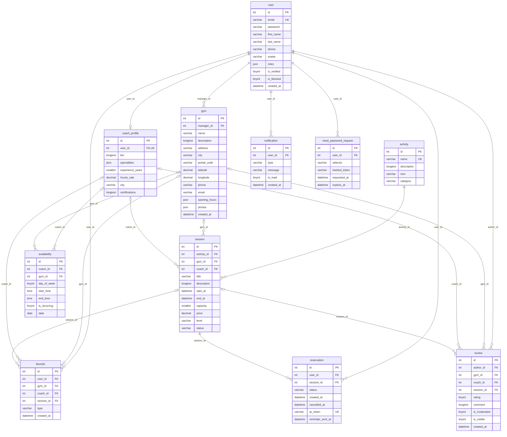

# MLD — Modèle logique de données (MySQL 8 et +)

> Version 1.0 — 5 novembre 2026 — statut : **à valider par les formateurs**
> Dérivé du [MCD](mcd.md). Les noms de tables et de colonnes sont ceux générés par Doctrine
> (entités en anglais, colonnes en `snake_case`). Moteur InnoDB, encodage `utf8mb4`.

**Légende :** **PK** clé primaire · **FK** clé étrangère · **UQ** unique · **NN** non nul · `#` = clé étrangère dans la notation textuelle.

---

## 1. Schéma relationnel (notation textuelle)

```text
user (id, email, password, first_name, last_name, phone, avatar, roles, is_verified, is_blocked, created_at)
coach_profile (id, #user_id, bio, specialities, experience_years, hourly_rate, city, certifications)
gym (id, #manager_id, name, description, address, city, postal_code, latitude, longitude, phone, email, opening_hours, photos, created_at)
activity (id, name, description, icon, category)
session (id, #activity_id, #gym_id, #coach_id, title, description, start_at, end_at, capacity, price, level, status)
availability (id, #coach_id, #gym_id, day_of_week, start_time, end_time, is_recurring, date)
reservation (id, #user_id, #session_id, status, created_at, cancelled_at, qr_token, reminder_sent_at)
favorite (id, #user_id, #gym_id, #coach_id, #session_id, type, created_at)
review (id, #author_id, #gym_id, #coach_id, #session_id, rating, comment, is_moderated, is_visible, created_at)
notification (id, #user_id, type, message, is_read, created_at)
reset_password_request (id, #user_id, selector, hashed_token, requested_at, expires_at)
```

Les clés `coach_id` désignent `coach_profile.id` (et non `user.id`).

## 2. Détail des tables

### `user`
| Colonne | Type | Contraintes |
|---------|------|-------------|
| id | INT AUTO_INCREMENT | **PK** |
| email | VARCHAR(180) | NN, **UQ** |
| password | VARCHAR(255) | NN — hash bcrypt/argon2 |
| first_name | VARCHAR(50) | NN |
| last_name | VARCHAR(50) | NN |
| phone | VARCHAR(20) | NULL |
| avatar | VARCHAR(255) | NULL — nom du fichier |
| roles | JSON | NN — ex. `["ROLE_COACH"]` |
| is_verified | TINYINT(1) | NN, défaut 0 |
| is_blocked | TINYINT(1) | NN, défaut 0 |
| created_at | DATETIME | NN |

### `coach_profile`
| Colonne | Type | Contraintes |
|---------|------|-------------|
| id | INT AUTO_INCREMENT | **PK** |
| user_id | INT | NN, **UQ**, **FK** → `user.id` ON DELETE CASCADE |
| bio | LONGTEXT | NULL |
| specialities | JSON | NN — liste de libellés |
| experience_years | SMALLINT | NULL, ≥ 0 |
| hourly_rate | DECIMAL(8,2) | NULL, ≥ 0 |
| city | VARCHAR(100) | NULL, index |
| certifications | LONGTEXT | NULL |

### `gym`
| Colonne | Type | Contraintes |
|---------|------|-------------|
| id | INT AUTO_INCREMENT | **PK** |
| manager_id | INT | NN, **FK** → `user.id` ON DELETE RESTRICT |
| name | VARCHAR(100) | NN |
| description | LONGTEXT | NULL |
| address | VARCHAR(255) | NN |
| city | VARCHAR(100) | NN, index |
| postal_code | VARCHAR(10) | NN |
| latitude | DECIMAL(9,6) | NULL |
| longitude | DECIMAL(9,6) | NULL |
| phone | VARCHAR(20) | NULL |
| email | VARCHAR(180) | NULL |
| opening_hours | JSON | NULL — ex. `{"lundi": "07:00-22:00"}` |
| photos | JSON | NN — liste de fichiers |
| created_at | DATETIME | NN |

### `activity`
| Colonne | Type | Contraintes |
|---------|------|-------------|
| id | INT AUTO_INCREMENT | **PK** |
| name | VARCHAR(50) | NN, **UQ** |
| description | LONGTEXT | NULL |
| icon | VARCHAR(100) | NULL |
| category | VARCHAR(50) | NN |

### `session`
| Colonne | Type | Contraintes |
|---------|------|-------------|
| id | INT AUTO_INCREMENT | **PK** |
| activity_id | INT | NN, **FK** → `activity.id` ON DELETE RESTRICT |
| gym_id | INT | NULL, **FK** → `gym.id` ON DELETE RESTRICT ¹ |
| coach_id | INT | NULL, **FK** → `coach_profile.id` ON DELETE RESTRICT ¹ |
| title | VARCHAR(100) | NN |
| description | LONGTEXT | NULL |
| start_at | DATETIME | NN, index (`status`, `start_at`) |
| end_at | DATETIME | NN |
| capacity | SMALLINT | NN |
| price | DECIMAL(8,2) | NN, défaut 0 |
| level | VARCHAR(20) | NN — `debutant` / `intermediaire` / `avance` |
| status | VARCHAR(20) | NN, défaut `active` — `active` / `annulee` |

Contraintes `CHECK` :
- `chk_session_dates` : `end_at > start_at`
- `chk_session_capacity` : `capacity >= 1`
- `chk_session_price` : `price >= 0`
- `chk_session_host` : `gym_id IS NOT NULL OR coach_id IS NOT NULL`

### `availability`
| Colonne | Type | Contraintes |
|---------|------|-------------|
| id | INT AUTO_INCREMENT | **PK** |
| coach_id | INT | NULL, **FK** → `coach_profile.id` ON DELETE CASCADE |
| gym_id | INT | NULL, **FK** → `gym.id` ON DELETE CASCADE |
| day_of_week | TINYINT | NULL — 1 (lundi) à 7 (dimanche) |
| start_time | TIME | NN |
| end_time | TIME | NN |
| is_recurring | TINYINT(1) | NN |
| date | DATE | NULL |

Contraintes `CHECK` :
- `chk_availability_owner` : `(coach_id IS NOT NULL) + (gym_id IS NOT NULL) = 1`
- `chk_availability_times` : `end_time > start_time`
- `chk_availability_kind` : `(is_recurring = 1 AND day_of_week BETWEEN 1 AND 7) OR (is_recurring = 0 AND date IS NOT NULL)`

### `reservation`
| Colonne | Type | Contraintes |
|---------|------|-------------|
| id | INT AUTO_INCREMENT | **PK** |
| user_id | INT | NN, **FK** → `user.id` ON DELETE CASCADE |
| session_id | INT | NN, **FK** → `session.id` ON DELETE CASCADE |
| status | VARCHAR(20) | NN — `confirmee` / `annulee` / `terminee` |
| created_at | DATETIME | NN |
| cancelled_at | DATETIME | NULL |
| qr_token | VARCHAR(64) | NULL, **UQ** |
| reminder_sent_at | DATETIME | NULL — évite l'envoi de deux rappels |

- **UQ** `uq_reservation_user_session` (`user_id`, `session_id`) — CI-02. Une réservation annulée
  puis refaite **réactive la même ligne** au lieu d'en créer une seconde.
- Index (`session_id`, `status`) pour compter rapidement les places prises (CI-03).

### `favorite`
| Colonne | Type | Contraintes |
|---------|------|-------------|
| id | INT AUTO_INCREMENT | **PK** |
| user_id | INT | NN, **FK** → `user.id` ON DELETE CASCADE |
| gym_id | INT | NULL, **FK** → `gym.id` ON DELETE CASCADE |
| coach_id | INT | NULL, **FK** → `coach_profile.id` ON DELETE CASCADE |
| session_id | INT | NULL, **FK** → `session.id` ON DELETE CASCADE |
| type | VARCHAR(20) | NN — `gym` / `coach` / `session` |
| created_at | DATETIME | NN |

- `chk_favorite_target` : `(gym_id IS NOT NULL) + (coach_id IS NOT NULL) + (session_id IS NOT NULL) = 1`
- **UQ** (`user_id`, `gym_id`), (`user_id`, `coach_id`), (`user_id`, `session_id`) — MySQL accepte
  plusieurs `NULL` dans un index unique, donc chaque index ne contraint que sa propre cible.

### `review`
| Colonne | Type | Contraintes |
|---------|------|-------------|
| id | INT AUTO_INCREMENT | **PK** |
| author_id | INT | NN, **FK** → `user.id` ON DELETE CASCADE |
| gym_id | INT | NULL, **FK** → `gym.id` ON DELETE CASCADE |
| coach_id | INT | NULL, **FK** → `coach_profile.id` ON DELETE CASCADE |
| session_id | INT | NULL, **FK** → `session.id` ON DELETE CASCADE |
| rating | TINYINT | NN |
| comment | LONGTEXT | NULL |
| is_moderated | TINYINT(1) | NN, défaut 0 |
| is_visible | TINYINT(1) | NN, défaut 1 |
| created_at | DATETIME | NN |

- `chk_review_rating` : `rating BETWEEN 1 AND 5`
- `chk_review_target` : exactement une cible (même règle que `favorite`)
- **UQ** (`author_id`, `gym_id`), (`author_id`, `coach_id`), (`author_id`, `session_id`)

### `notification`
| Colonne | Type | Contraintes |
|---------|------|-------------|
| id | INT AUTO_INCREMENT | **PK** |
| user_id | INT | NN, **FK** → `user.id` ON DELETE CASCADE |
| type | VARCHAR(50) | NN |
| message | VARCHAR(255) | NN |
| is_read | TINYINT(1) | NN, défaut 0 |
| created_at | DATETIME | NN |

### `reset_password_request`
Table gérée par **SymfonyCasts ResetPasswordBundle** : `id` (PK), `user_id` (FK → `user.id`,
ON DELETE CASCADE), `selector` VARCHAR(20), `hashed_token` VARCHAR(100), `requested_at`, `expires_at`.

> La vérification d'e-mail (**VerifyEmailBundle**) utilise un lien signé : aucune table supplémentaire.

## 3. Suppressions en cascade

¹ **Pourquoi `RESTRICT` pour la salle et le coach d'une séance ?** Un `SET NULL` pourrait laisser
une séance sans salle **ni** coach, ce que refuse `chk_session_host` : MySQL ferait alors échouer
la suppression (vérifié sur le serveur du projet, MySQL 9.1). Surtout, supprimer une salle ou un
coach ne doit pas effacer silencieusement des séances réservées : on **annule** d'abord les séances
(les sportifs sont prévenus), puis on supprime.

| Suppression de… | Effet |
|-----------------|-------|
| un utilisateur | Ses réservations, favoris, avis, notifications et demandes de réinitialisation sont supprimés (CASCADE), ainsi que son profil coach. Refusée s'il gère encore une salle ou si son profil coach anime encore des séances. |
| une salle | Refusée si des séances y sont rattachées. Ses disponibilités, favoris et avis sont supprimés (CASCADE). |
| un profil coach | Refusée s'il anime encore des séances. Ses disponibilités, favoris et avis sont supprimés (CASCADE). |
| une séance | Ses réservations, favoris et avis sont supprimés (CASCADE). En pratique, une séance est **annulée** plutôt que supprimée. |

## 4. Procédures stockées

Versionnées dans `database/procedures/*.sql` (exécutables tels quels dans le client `mysql`) et
installées par la migration `Version20261105150000`, qui lit ces mêmes fichiers.

| Procédure | Paramètres | Rôle | Résultat |
|-----------|------------|------|----------|
| `sp_reserver_seance` | `IN p_user_id`, `IN p_session_id`, `OUT p_code`, `OUT p_reservation_id` | Verrouille la séance (`SELECT … FOR UPDATE`), vérifie statut, date, doublon et capacité, puis insère (ou réactive) la réservation | `p_code` : `0` OK, `1` séance introuvable, `2` séance indisponible, `3` déjà réservée, `4` complète |
| `sp_annuler_reservation` | `IN p_reservation_id`, `IN p_user_id`, `OUT p_code` | Annule si la réservation appartient à l'utilisateur et si la séance commence dans plus de 2 h | `p_code` : `0` OK, `1` introuvable, `2` non propriétaire, `3` trop tard, `4` déjà annulée ou terminée |
| `sp_stats_salle` | `IN p_gym_id` | Statistiques du tableau de bord gestionnaire | Une ligne : `nb_seances`, `capacite_totale`, `nb_reservations`, `taux_remplissage` (%), `note_moyenne`, `nb_avis` (avis visibles) |

Exemple : `CALL sp_reserver_seance(12, 34, @code, @id); SELECT @code, @id;`

- Les deux procédures d'écriture **gèrent leur propre transaction** (`START TRANSACTION … COMMIT`,
  `ROLLBACK` en cas d'erreur) : elles ne doivent pas être appelées dans une transaction déjà ouverte.
- Les dates sont comparées avec `UTC_TIMESTAMP()` (voir § 5).

## 5. Choix techniques de la base (Phase 2)

| Choix | Raison |
|-------|--------|
| **Moteur InnoDB imposé** (`default_table_options` dans `doctrine.yaml`) | Le MySQL de WAMP crée les tables en **MyISAM** par défaut : ce moteur ignore silencieusement les clés étrangères, les transactions et les verrous `FOR UPDATE`. L'ancienne version du site en était victime : son verrou de réservation ne protégeait rien. |
| **Dates stockées en UTC** | PHP (UTC) et MySQL (heure de Paris) n'avaient pas le même fuseau : `NOW()` aurait décalé la règle des 2 h. Le Kernel fixe PHP en UTC, les procédures utilisent `UTC_TIMESTAMP()` et l'API renvoie des dates ISO 8601 avec décalage (`2026-11-10T09:00:00+00:00`), que le navigateur affiche à l'heure locale. |
| **Utilisateur `fitbook_user`** | Droits limités à `fitbookdata` et `fitbookdata_test`, aucun droit global (`database/scripts/create_user.sql`). |

## 6. Diagramme


