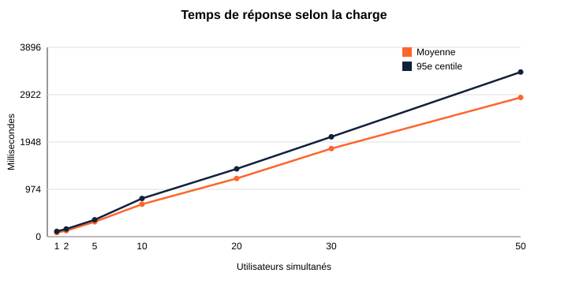
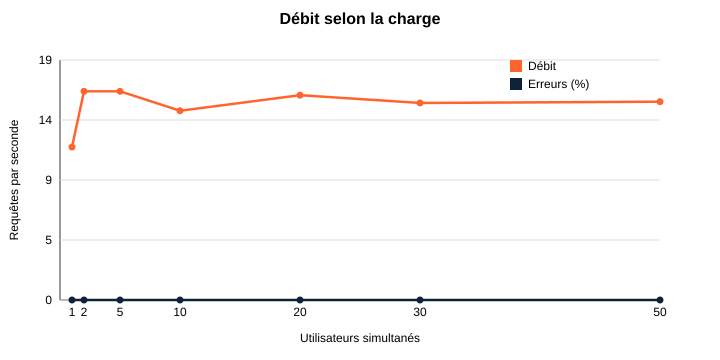

# Tests de charge — courbes de stress

Mesure du comportement de l'API quand le nombre d'utilisateurs simultanés augmente
(grille d'évaluation : « Les courbes de stress sont présentes »).

## Protocole

- **Script** : [`charge.py`](charge.py), bibliothèque standard Python uniquement.
- **Charge** : 1 → 50 utilisateurs simultanés, 10 secondes par palier, chacun enchaînant sans pause
  des lectures publiques : recherche de séances, activités, salles, coachs.
- **API en mode production** (`APP_ENV=prod`, `APP_DEBUG=0`, cache préchauffé, OPcache actif),
  servie par le serveur intégré de PHP, base MySQL de développement (fixtures).
- **Poste** : Windows 11, WAMP (PHP 8.3.14, MySQL 9.1), tout sur la même machine.

```bash
cd backend
php bin/console cache:clear --env=prod --no-debug
# APP_SECRET : n'importe quelle valeur aléatoire pour le test
APP_ENV=prod APP_DEBUG=0 APP_SECRET=... php -d variables_order=EGPCS -S 127.0.0.1:8001 -t public public/index.php
# autre terminal, depuis la racine du projet
python docs/tests-de-charge/charge.py --url http://127.0.0.1:8001 --paliers 1,2,5,10,20,30,50 --duree 10
```

## Résultats (6 novembre 2026)

| Utilisateurs | Requêtes | Débit (req/s) | Moyenne (ms) | 95e centile (ms) | Erreurs |
|---:|---:|---:|---:|---:|---:|
| 1 | 119 | 11,8 | 85 | 109 | 0 % |
| 2 | 163 | 16,1 | 124 | 159 | 0 % |
| 5 | 166 | 16,1 | 306 | 347 | 0 % |
| 10 | 155 | 14,6 | 668 | 786 | 0 % |
| 20 | 178 | 15,8 | 1 198 | 1 396 | 0 % |
| 30 | 182 | 15,2 | 1 813 | 2 055 | 0 % |
| 50 | 202 | 15,3 | 2 865 | 3 388 | 0 % |

Données brutes : [`resultats.csv`](resultats.csv).





## Interprétation

- **Aucune erreur** jusqu'à 50 utilisateurs simultanés : l'API reste stable sous charge.
- **Un utilisateur seul** obtient une réponse en 85 ms en moyenne (110 ms pour 95 % des requêtes).
- **Saturation dès 2 utilisateurs** : le débit plafonne autour de **16 requêtes par seconde**, puis
  le temps de réponse augmente proportionnellement au nombre d'utilisateurs (file d'attente).
  Ce plafond vient du **serveur intégré de PHP, qui traite une requête à la fois** : c'est la
  limite de l'environnement de test, pas celle du code.
- **À titre de comparaison**, en mode développement (débogage, profiler) la même API répond en
  600 à 1 000 ms par requête : le mode production est environ 8 fois plus rapide.
- **En production** (Nginx + PHP-FPM avec plusieurs processus, voir [`deploiement.md`](../deploiement.md)),
  le débit augmente avec le nombre de processus PHP-FPM ; il faudrait refaire la mesure sur le
  serveur cible pour le dimensionner.

## Limites

- Lectures publiques seulement : les écritures (réservation) sont couvertes par les tests de
  capacité (procédure stockée `sp_reserver_seance`, verrou `FOR UPDATE`) plutôt que par la charge.
- Client et serveur sur la même machine : le client consomme une partie du processeur.
