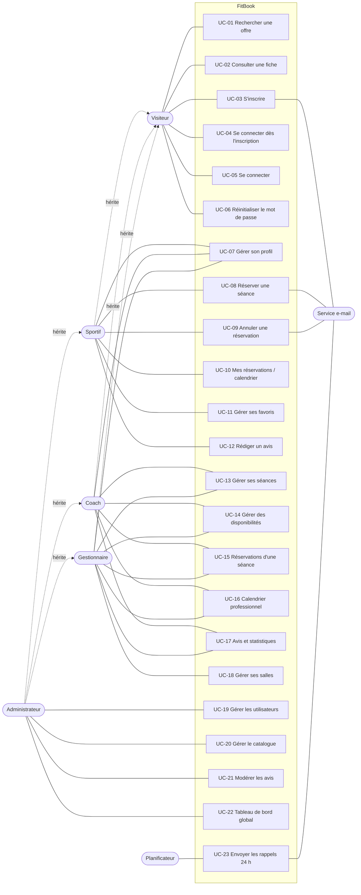

# Cas d'utilisation — FitBook

> Version 1.0 — 5 novembre 2026 — statut : **à valider par les formateurs**
> À reproduire dans **StarUML** (diagramme de cas d'utilisation UML).
> Chaque cas renvoie aux [user stories](user-stories.md) qu'il réalise.

---

## 1. Acteurs

| Acteur | Type | Hérite de |
|--------|------|-----------|
| Visiteur | Principal, humain | — |
| Sportif | Principal, humain | Visiteur (connecté) |
| Coach | Principal, humain | Visiteur (connecté) |
| Gestionnaire | Principal, humain | Visiteur (connecté) |
| Administrateur | Principal, humain | Sportif, Coach, Gestionnaire |
| Service e-mail (Mailer) | Secondaire, système | — |
| Planificateur (cron) | Secondaire, système | — |

> L'administrateur hérite de tous les rôles (`ROLE_ADMIN` > tous) : il peut réaliser
> tous les cas d'utilisation des autres acteurs connectés.

## 2. Liste des cas d'utilisation

| ID | Cas d'utilisation | Acteur principal | User stories |
|----|-------------------|------------------|--------------|
| UC-01 | Rechercher une offre (salle, coach, séance) | Visiteur | US-V01, US-V02, US-V03 |
| UC-02 | Consulter une fiche | Visiteur | US-V04 |
| UC-03 | S'inscrire | Visiteur | US-V05 |
| UC-04 | Se connecter dès l'inscription | Visiteur | US-V06 |
| UC-05 | Se connecter | Visiteur | US-S01 |
| UC-06 | Réinitialiser son mot de passe | Visiteur | US-V07 |
| UC-07 | Gérer son profil | Utilisateur connecté | US-S07, US-C01 |
| UC-08 | Réserver une séance | Sportif | US-S02 |
| UC-09 | Annuler une réservation | Sportif | US-S03 |
| UC-10 | Consulter ses réservations et son calendrier | Sportif | US-S04 |
| UC-11 | Gérer ses favoris | Sportif | US-S05 |
| UC-12 | Rédiger un avis | Sportif | US-S06 |
| UC-13 | Gérer ses séances | Coach, Gestionnaire | US-C02, US-G02 |
| UC-14 | Gérer des disponibilités | Coach, Gestionnaire | US-C03, US-G03 |
| UC-15 | Consulter les réservations d'une séance | Coach, Gestionnaire | US-C05, US-G04 |
| UC-16 | Consulter son calendrier professionnel | Coach, Gestionnaire | US-C04 |
| UC-17 | Consulter ses avis et statistiques | Coach, Gestionnaire | US-C06, US-G05, US-G06 |
| UC-18 | Gérer ses salles | Gestionnaire | US-G01 |
| UC-19 | Gérer les utilisateurs | Administrateur | US-A02 |
| UC-20 | Gérer le catalogue (salles, coachs, activités, réservations) | Administrateur | US-A03 |
| UC-21 | Modérer les avis | Administrateur | US-A04 |
| UC-22 | Consulter le tableau de bord global | Administrateur | US-A01 |
| UC-23 | Envoyer les rappels 24 h | Planificateur | US-S08 |

**Relations entre cas :**
- UC-08, UC-09, UC-11, UC-12, UC-13 à UC-22 **« include »** UC-05 *Se connecter* (accès réservé).
- UC-03 **« include »** *Envoyer l'e-mail de confirmation* ; UC-08 et UC-09 **« include »**
  *Envoyer l'e-mail de réservation / d'annulation* (acteur secondaire : Service e-mail).
- UC-02 **« extend »** UC-08 (point d'extension : bouton « Réserver » sur la fiche d'une séance)
  et UC-11 (bouton favori).
- *Annuler les réservations d'une séance* **« extend »** UC-13 (point d'extension : annulation
  d'une séance qui a des inscrits) ; il **« include »** l'envoi d'un e-mail à chaque sportif.

## 3. Diagramme

> Mermaid n'a pas de diagramme de cas d'utilisation UML : les acteurs sont en ovale et les
> héritages en pointillés. Dans StarUML, utiliser les relations *Generalization* pour
> l'héritage entre acteurs, et *Include* / *Extend* pour les relations du § 2.

## 4. Scénarios détaillés

**Convention des réponses d'erreur de l'API** (appliquée dans tous les scénarios) :

| Code | Cas | Corps |
|------|-----|-------|
| 400 | JSON mal formé | `{ "message": "…" }` |
| 401 | Non authentifié ou jeton expiré | `{ "message": "…" }` |
| 403 | Authentifié mais non autorisé (rôle, Voter, compte bloqué) | `{ "message": "…" }` |
| 404 | Ressource introuvable | `{ "message": "…" }` |
| 409 | Conflit métier (doublon, séance complète, délai dépassé) | `{ "message": "…" }` |
| 422 | Données invalides (Symfony Validator ou JSON Schema) | `{ "message": "…", "errors": { "champ": "message" } }` |

### UC-03 — S'inscrire

| | |
|---|---|
| **Acteur** | Visiteur (secondaire : Service e-mail) |
| **Préconditions** | Le visiteur n'est pas connecté. |
| **Postconditions** | Un compte actif existe ; l'utilisateur peut se connecter immédiatement. |

**Scénario nominal**
1. Le visiteur ouvre `/inscription`.
2. Il saisit prénom, nom, e-mail, téléphone, mot de passe et choisit son rôle (sportif, coach, gestionnaire).
3. Le système valide les champs côté client, puis côté serveur.
4. Le système crée le compte actif (`isVerified = true`) avec le mot de passe haché.
5. Le système envoie un e-mail de bienvenue (un échec d'envoi ne bloque rien).
6. Le système connecte automatiquement le nouveau compte et ouvre son espace (« Compte créé avec succès. Bienvenue sur FitBook ! »).

**Scénarios alternatifs**
- 3a. Un champ est invalide → **422** ; le système affiche l'erreur sous le champ ; retour à l'étape 2.
- 3b. L'adresse est déjà utilisée → réponse 409, message sur le champ e-mail.
- 3c. Le rôle envoyé est `ROLE_ADMIN` ou inconnu → réponse 422, compte non créé.
- 5a. L'envoi de l'e-mail échoue → le compte est conservé ; le visiteur peut demander un nouveau lien.

### UC-08 — Réserver une séance

| | |
|---|---|
| **Acteur** | Sportif (secondaire : Service e-mail) |
| **Préconditions** | Le sportif est connecté (JWT valide) et son compte n'est pas bloqué. |
| **Postconditions** | Une réservation `confirmee` existe ; une place de moins est disponible. |

**Scénario nominal**
1. Depuis la fiche d'une séance, le sportif clique sur **Réserver**.
2. Le front envoie `POST /api/reservations` ; le corps est validé par le JSON Schema `reservation.schema.json`.
3. Le système appelle `sp_reserver_seance` dans une transaction (verrou pessimiste sur la séance).
4. La procédure vérifie : séance active et future, absence de doublon, places restantes.
5. La procédure insère la réservation et renvoie le code `0`.
6. Le système envoie l'e-mail de confirmation et renvoie **201**.
7. Le front affiche un toast de succès et met à jour le nombre de places.

**Scénarios alternatifs**
- 1a. Le sportif n'est pas connecté → redirection vers `/connexion`, puis retour à la fiche.
- 2a. Corps non conforme au schéma → **422** avec `{ "errors": { … } }`.
- 4a. Séance complète → code `4`, réponse **409** « Plus de place disponible ».
- 4b. Déjà réservée → code `3`, réponse **409** « Vous avez déjà réservé cette séance ».
- 4c. Séance passée ou annulée → code `2`, réponse **409**.
- 4d. Séance introuvable → code `1`, réponse **404**.

### UC-09 — Annuler une réservation

| | |
|---|---|
| **Acteur** | Sportif (secondaire : Service e-mail) |
| **Préconditions** | Le sportif est connecté et possède une réservation `confirmee`. |
| **Postconditions** | La réservation est `annulee`, `cancelledAt` renseigné, la place est libérée. |

**Scénario nominal**
1. Dans « Mes réservations », le sportif clique sur **Annuler** ; une fenêtre de confirmation s'ouvre.
2. Il confirme ; le front envoie la demande d'annulation.
3. Le système appelle `sp_annuler_reservation`, qui vérifie la propriété et le délai de 2 h.
4. La réservation passe à `annulee` ; le système envoie l'e-mail d'annulation et renvoie **200**.

**Scénarios alternatifs**
- 3a. La séance commence dans moins de 2 h → code `3`, réponse **409** avec le motif.
- 3b. La réservation appartient à un autre utilisateur → code `2`, réponse **403**.
- 3c. Déjà annulée → code `4`, réponse **409**.

### UC-12 — Rédiger un avis

| | |
|---|---|
| **Acteur** | Sportif |
| **Préconditions** | Le sportif est connecté et a une réservation `terminee` liée à la cible. |
| **Postconditions** | Un avis visible existe pour la cible ; la note moyenne est recalculée. |

**Scénario nominal**
1. Sur la fiche d'une salle, d'un coach ou d'une séance, le sportif clique sur **Donner mon avis**.
2. Il choisit une note de 1 à 5 et saisit un commentaire facultatif.
3. Le système vérifie la réservation terminée et l'absence d'avis existant sur la cible.
4. Le système enregistre l'avis (`isVisible = true`, `isModerated = false`) et renvoie **201**.

**Scénarios alternatifs**
- 3a. Aucune réservation terminée → **403** « Vous devez avoir participé pour donner un avis ».
- 3b. Un avis existe déjà → **409** ; le front propose de modifier l'avis existant.

### UC-13 — Gérer ses séances (coach)

| | |
|---|---|
| **Acteur** | Coach (ou gestionnaire pour les séances de ses salles) |
| **Préconditions** | Connecté avec `ROLE_COACH` (ou `ROLE_GESTIONNAIRE`). |
| **Postconditions** | La séance est créée, modifiée ou annulée. |

**Scénario nominal (création)**
1. Dans `/coach`, le coach ouvre **Nouvelle séance**.
2. Il renseigne titre, activité, salle (facultative), début, fin, capacité, prix, niveau.
3. Le système valide (`fin > début`, `capacité ≥ 1`, `prix ≥ 0`) et rattache la séance à son profil.
4. La séance apparaît dans son calendrier et dans la recherche.

**Scénarios alternatifs**
- 3a. Données invalides → **422** avec le détail par champ.
- 3b. Modification d'une séance d'un autre coach → refus du Voter, **403**.
- 3c. Annulation d'une séance avec inscrits → les réservations passent à `annulee` et les
  sportifs reçoivent un e-mail.

### UC-21 — Modérer les avis

| | |
|---|---|
| **Acteur** | Administrateur |
| **Préconditions** | Connecté avec `ROLE_ADMIN`. |
| **Postconditions** | L'avis est validé (`isModerated = true`) ou masqué (`isVisible = false`). |

**Scénario nominal**
1. Dans `/admin`, l'administrateur ouvre la liste des avis filtrée sur « non modérés ».
2. Pour chaque avis, il choisit **Valider** ou **Masquer**.
3. Un avis masqué disparaît des fiches et n'entre plus dans la note moyenne.

**Scénario alternatif**
- 2a. Un utilisateur non administrateur tente l'action → **403**.
